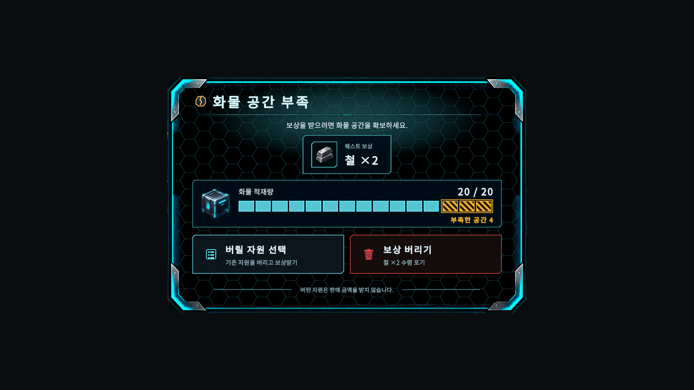

# B-152 화물 공간 부족 팝업 결과

## 구현

- 기존 `QuestRewardCapacityPanel`에 `CargoFullPopupView`를 붙였다. 판매창과 같은 철제 껍데기(`ResourceSellPopupView.BuildPanelLayers`)와 장식은 실행 중에 코드로 만든다.
  - 씬의 `CapacityTitle`, `CapacityBody`, `CapacityDumpButton`, `CapacityForfeitButton`은 이름과 onClick을 그대로 두고 위치와 모양만 바꿔 다시 쓴다.
- 배치(위→아래): 경고 아이콘 + "화물 공간 부족" / 구분선 / 안내 / 보상 카드(아이콘 + "퀘스트 보상" + "철 ×2") / 화물 게이지(현재/최대, 12칸 + 초과 칸, 호박색 "부족한 공간 N") / 선택 두 칸 / 양옆 선 + "버린 자원은 판매 금액을 받지 않습니다."
- 크기는 1000×660(기준 1920×1080). 1280×720에서도 잘리지 않는 것을 렌더 캡처로 확인했다.
- 순수 클래스
  - `CargoShortfallModel`(Tutorial): 부족 = `CurrentWeight + 보상 무게 − MaxCapacity`(0 미만은 0, 소수 둘째 자리 반올림)와 게이지 칸 계산.
  - `CargoFullPopupText`: 문구. 무게는 `HudFormatter.FormatCargoAmount`로 표시한다.
  - `CargoFullPopupTimeline` / `CargoFullPopupTiming`: 연출 시간표. 인스펙터 값이며, 열기가 0.6초를 넘으면 비율을 유지한 채 줄인다.
  - `CargoFullChoiceGate`: 한 번만 통과하는 선택 문.
- `QuestRewardService.DescribeCargoShortfall()`: 표시용 읽기 전용 메서드만 추가했다. 보상 무게는 `PendingReward.ComputeMineralWeight(catalog)`이고 골드는 들어가지 않는다. 지급·포기·재시도 규칙은 그대로다.
- `IDemoObjectiveView.SetCapacityChoice(CargoShortfallModel, QuestReward)`를 추가했다. Presenter의 capacityOpen/dumpOpen/claimOpen 흐름은 그대로다.
- 빌더: `SubTerra/UI/Build Prompt-B 152 Cargo Full Popup`(`PromptB152CargoFullPopupBuilder`).
  - `Resources/UI/CargoFullPopupSkin.asset`을 만든다.
  - 씬에서는 `QuestRewardCapacityPanel`에 컴포넌트를 붙이고, 패널 크기와 버튼 문구를 바꾸고, `DemoObjectiveView.capacityPopup` 참조를 연결한다.

## 부족 계산식과 칸 규칙

- 칸당 무게 = 최대 적재량 / 칸 수(기본 12, 인스펙터 4~40).
- 채운 칸 = 반올림(현재 / 칸당 무게).
  - 0보다 크면 최소 1칸이다.
  - 가득 차지 않았으면 마지막 칸은 비운다.
- 초과 칸 = ceil(부족 / 칸당 무게)를 1 ~ maxOverflowCells(기본 4, 인스펙터 1~8)로 자른다. 부족하지 않으면 0이다.
- 예시: 20/20 + 철×2 → 부족 4, 초과 3칸. 19/20 + 구리×1 → 부족 0.5, 초과 1칸.

## 연출

- 열기(0.59초): 가운데 가로 빛 → 창이 위아래로 펼쳐짐 → 테두리 섬광 1회 → 내용 페이드 인 → 게이지가 0.24초 동안 참 → 초과 칸이 한 번 밝아짐. 그 뒤 값이 고정되고, 계속 깜빡이는 연출은 없다.
- 닫기(0.2초): 내용이 빠지고 가운데 선으로 접힌다.
  - 선택 창이나 클리어 창이 바로 이어지면 접힘이 끝난 뒤에 띄워 두 창이 겹치지 않게 한다.
- 호버·키보드 포커스: `CargoFullChoiceButton`이 판매창 버튼 규칙대로 면 밝기, 테두리, 발광을 바꾼다. 클릭하면 짧게 눌린다.

## 중복 처리 방지

- View: 열기 연출 중에는 두 버튼이 잠겨 있다. 한쪽을 누르면 `CargoFullChoiceGate`가 두 버튼을 함께 잠근다.
- Presenter: `ChooseDumpInventory`와 `ChooseForfeitReward`는 화물 부족 창이 열려 있을 때만 동작한다.
  - 연타가 다음 보상까지 포기하던 경로를 막는다.
  - 정상 흐름에서는 동작이 같다.
- 입력 잠금(`SetInputLocked`)은 건드리지 않는다. 닫은 뒤 `IsInputLocked == false`를 테스트로 확인했다.

## 그림

- 재사용
  - 판매창 프레임/패널/육각 무늬(MineResetTimedPopupSkin 읽기만)
  - mine-reset-frame-glow, mine-reset-title-divider, mine-reset-scanline
  - structural-caution(경고)
  - upgrade-icon-box(화물함)
  - icon-trash-white(붉게 칠해 사용)
  - icon_copper/iron/lithium, quest-icon-gold
  - 판매창 각진 면·테두리(ResourceSellArt)
- 신규(코드 생성, Point 필터): 목록 아이콘, 게이지 칸, 1px 테두리, 사선 줄무늬 초과 칸. 새 이미지 파일은 없다.
- 붉은 버튼은 button-danger-on이 붉은 면을 넓게 칠해서 쓰지 않았다. 대신 어두운 면에 붉은 테두리를 그렸다. 청록 버튼도 같은 형식으로 맞췄다.

## 확인 결과

- SurfaceBasePanel.prefab의 `SurfaceQuestRoot/DemoObjectiveView`는 `capacityRoot`, `dumpRoot`, `claimRoot`가 모두 비어 있다.
  - 지상에서 보상이 막히면 화물 부족 창이 뜨지 않는다.
  - 프롬프트대로 고치지 않았다.
- "버릴 자원 선택"은 선택 창(QuestRewardDumpPanel)을 연다. 바로 버리는 경로는 없다.
- QuestRewardDumpPanel은 이전 단색 스타일 그대로라 새 팝업과 모양이 다르다. 보고만 한다.

## 테스트

- 새 EditMode `PromptB152CargoFullPopupTests` 14개 전부 통과.
  - 부족 계산: 20/20 + 철×2 → 4, 19/20 + 구리×1 → 0.5, 0 미만 없음, 골드 제외
  - 칸 수 상·하한
  - "N 수령 포기" 문구: 보상 한 종류 / 여러 종류
  - 타임라인: 0.6초 이내, 초과 칸 섬광 1회, 끝난 뒤 값 고정
  - Presenter 연타 시 ForfeitPending / 선택 창 열기가 한 번만 실행
  - View 동시 클릭이 하나만 통과, 닫힘 뒤 선택 창이 이어 뜸
  - 닫은 뒤 `IsInputLocked == false`
  - 씬 이름·onClick 유지, 스킨 경로
- `PromptB95QuestRewardTests`의 버튼 문구 검사를 새 문구로 고쳤다. 패널 이름 검사는 그대로 통과한다.
- B-152, B-95, B-107, 전환 테스트 묶음: 60 통과 / 0 실패.
- 전체 EditMode: 1843 통과 / 17 실패.
  - 16개는 이번 변경과 무관한 기존 실패다(빌딩 패널 폭, HUD 수치, 스냅샷 필드, 시설 타일맵, `PlayableMineScene` 지형, 판매 모달 위치, B138 부동소수 오차 등). B-151 보고의 기존 실패 목록과 같은 계열이다.
  - `PromptB107QuestUiTests.Scene_UsesQuestFramesWithoutCoveringTheFacilityPanel`은 전체 실행에서만 "저장되지 않은 변경" 예외로 실패했다. 앞선 다른 테스트가 씬을 더럽힌 채 남긴 것이 원인이다. 묶음 실행에서는 통과한다.
- 전체 실행 중 기존 테스트의 빌더가 폰트, 프리팹, ProjectSettings, 증거 PNG, 씬을 건드렸다.
  - 모두 `git restore`로 원복했다.
  - 씬은 원복한 뒤 B-152 빌더만 다시 적용했다.
- 씬 diff에는 B-152 변경 외에 기존 컴포넌트의 기본값 필드가 다시 직렬화된 줄도 들어 있다(RunFailurePanelView 필드, maxAlpha, particleColor, failureDisplaySeconds 제거). 에디터 API로 저장할 때 생기며 동작에는 영향이 없다.
- PlayMode: 이번에 추가하거나 고친 PlayMode 테스트가 없다.

## 미검증

- Bootstrap부터 실제 플레이 흐름에서 수동 체크리스트 전체를 확인하지 못했다. 렌더 캡처와 EditMode 테스트로만 확인했다.
  - 실제 HUDCanvas 위 표시, 클릭, 호버, 키보드 포커스, 커서 동작
