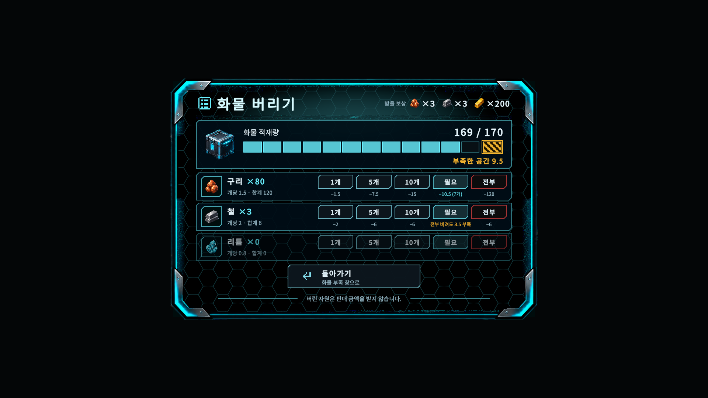

# B-153 화물 버리기 창 결과

## 구현

- 기존 `QuestRewardDumpPanel`에 `CargoDiscardPopupView`를 붙였다. 프레임·배경·헤더·게이지·카드 버튼·꼬리말은 B-152와 같은 공용 코드로 실행 중에 만든다.
  - 씬의 `DumpTitle`, `DumpCopper/DumpIron/DumpLithium`(`Label`, `DumpOne`, `DumpAll`), `DumpCloseButton`은 이름과 onClick을 그대로 두고 위치와 모양만 바꿨다.
  - 줄마다 `DumpFive`, `DumpTen`, `DumpNeeded` 버튼을 추가했다(기존 `DumpOne`/`DumpAll` 형제 규칙). onClick은 `OnDump{Copper|Iron|Lithium}{Five|Ten|Needed}Clicked`.
  - `DumpSummary`(현재 화물 … · 보상 중량 …)는 참조만 남기고 끈다. 게이지가 대신한다.
- 배치(위→아래, 1000×660): 목록 아이콘 + "화물 버리기" + 오른쪽 "받을 보상 [아이콘 ×N]…" / 구분선 / 공용 게이지 / 자원 3줄 / "돌아가기 · 화물 부족 창으로" 카드 / 꼬리말.
  - 줄: 도트 아이콘 + 이름 + "×80", 아래 "개당 2 · 합계 160". 오른쪽 1개·5개·10개·필요·전부(같은 폭 96), 버튼 아래 비워지는 양("−15", "−10 (5개)", "전부 버려도 3.5 부족").
  - 0개 줄은 그대로 자리를 지키고 흐리게(알파 0.38) + 버튼 비활성.
  - 1개·5개·10개는 청록 중립, 필요는 밝은 청록 + 밝은 면, 전부는 어두운 면 + 붉은 테두리.
- 1920×1080과 1280×720 렌더 캡처에서 글자 넘침이 없었다.

## 공용으로 뺀 것 (B-152와 같이 씀)

- `CargoGaugeView`: 화물함 아이콘 + 화물 적재량 + 현재/최대 + 12칸 + 초과 칸 + 부족 문구. 부족이 0일 때 문구(버리기 창은 "공간 확보 완료")만 다르다.
- `CargoPopupFrame`: 배경 막·철제 껍데기·내용 층·스캔선, 열기/접기 자세와 페이지 전환 자세.
- `CargoPopupChrome`: 헤더, 카드 버튼(`CargoFullChoiceButton` 연결), 작은 수량 버튼, 판, 배치 도우미. `CargoPopupFooter`: 꼬리말.
- `CargoFullPopupView`는 위 공용 코드로 바꿨다. 화면은 이전 캡처와 같고 B-152 테스트 14개는 그대로 통과한다.

## 수량 규칙

- `CargoDiscardMath`(순수 클래스)
  - `Clamp(요청, 보유)` = min(요청, 보유), 0 미만 없음. 전부(int.MaxValue) = 보유 수.
  - `Needed(부족, 개당, 보유)` = ceil((round2(부족) − 1e-4) / round2(개당))를 보유 수로 자른다. 모자라면 보유 전부 + 남는 부족.
  - 예: 부족 9.5 → 철 5, 구리 7, 리튬 12. 3.0/1.5 = 2, 4/2 = 2.
- Presenter `DumpMineral`이 모든 요청을 보유 수로 자른 뒤 기존 `Dump → CanFitPending → RetryPending` 경로를 그대로 탄다. 판매 경로는 부르지 않는다.
- 0개 줄에도 개당 무게를 보여 주려고 `QuestRewardService.GetDumpRowsForDisplay()`(읽기 전용)를 추가했다. 지급·포기·재시도 규칙은 그대로다.

## 연출

- 페이지 전환(화물 부족 ↔ 화물 버리기, 약 0.25초): 프레임은 펼친 채로 두고 이전 내용이 0.09초에 빠진 뒤, 새 창이 같은 자리에 프레임째 나타나 가로 스캔선이 위→아래로 0.16초 지나가며 내용을 드러낸다. 접혔다 펴지지 않고, 두 창이 동시에 켜지지 않는다.
  - 기존 `dumpAfterCapacityClose` 순서를 그대로 쓰고, 돌아가기용 `capacityAfterDumpClose`를 같은 방식으로 추가했다.
  - 페이지 넘김으로 닫기 시작했는데 이어질 창이 없으면(예: 돌아가기에서 바로 지급) 평소처럼 접는다.
- 버릴 때: 게이지·현재/최대·부족 숫자가 0.2초 동안 부드럽게 줄고, 해당 줄 수량 숫자가 한 번 밝아진다.
- 공간 확보 완료: 부족이 0이 되면 게이지 끝 칸과 문구가 청록 "공간 확보 완료"로 한 번 밝아진다. 지급은 그 순간 이미 끝났고, 0.4초 보여 준 뒤 접힌다. 그동안 모든 버튼은 잠긴다. 다음 클리어 창은 접힘이 끝난 뒤 뜬다.
- 반복 깜빡임 없음. 시간 값은 `CargoDiscardTiming`(인스펙터), 계산은 `CargoDiscardTimeline`.

## 중복 처리 방지

- View: 열기·페이지 전환·완료 표시·닫기 중에는 문(`CargoFullChoiceGate`)이 닫혀 있다. 수량 버튼은 한 번에 하나만 통과하고 Presenter 처리가 끝나면 다시 연다. 부족이 0이 되면 다시 열지 않는다.
- 돌아가기·X 키도 열린 상태에서 한 번만 통과한다. 닫히는 중의 X 키는 무시한다.
- Presenter: 지급 뒤에는 `dumpOpen`이 꺼져 늦은 클릭이 무시된다(기존 동작).

## 글꼴 누락 원인과 수정

- 팝업 글자는 씬 제목 글자의 폰트 `Fonts/NotoSansKR-Regular_SDF.asset`(Dynamic, 원본 TTF 연결, fallback 없음)을 쓴다.
- 원인: 에디터 메모리의 글자 조회표에는 '린'(U+B9B0)·'액'(U+C561)·'칩'(U+CE69)이 있었지만, 저장된 글자 표(588자)에는 없었고 조회표가 가리키는 아틀라스 칸은 비어 있었다(최대 알파 0).
  - 동적으로 추가된 글자가 메모리에만 남은 상태에서 에셋이 디스크 값으로 되돌아가면(테스트 뒤 `git restore` 등) 텍스처만 되돌아가고 조회표는 옛 칸을 그대로 가리킨다. 그래서 글자 폭은 있는데 빈칸으로 그려진다("버  자원", "금  을").
- 수정: `KoreanFontAssetUtility.EnsureCharactersSaved`를 추가했다. 저장된 표로 조회표를 다시 만든 뒤 빠진 글자만 넣고 에셋을 저장한다.
  - B-153 빌더가 B-152·B-153 모든 문구 글자(`CargoDiscardText.FontCharacters`)로 이를 호출한다. 이번에 '린', '액', '−'가 추가됐다(588 → 591자, 첫 아틀라스 안).
  - fallback은 연결하지 않았다. 다른 화면 글자 모양은 바뀌지 않는다.

## 빌더

- `SubTerra/UI/Build Prompt-B 153 Cargo Discard Popup`(`PromptB153CargoDiscardPopupBuilder`): 위 폰트 글자 저장, `QuestRewardDumpPanel` 아래 버튼 추가·문구·onClick, `CargoDiscardPopupView` 부착, `DemoObjectiveView.dumpPopup` 연결. 패널은 꺼진 상태로 저장한다.
- 씬 diff는 버튼 9개(각 Label 포함)와 View 컴포넌트 1개(82개 오브젝트), 패널 크기, 버튼 문구뿐이다. `IntegrationRuntimeBinder` 참조는 HEAD와 같다(비어 있던 5개도 원래부터 비어 있음).
- `PromptB95QuestRewardUiBuilder`의 버리기 버튼 문구를 "1개"/"전부"로 맞췄다. 다시 돌려도 옛 문구로 돌아가지 않는다.

## 테스트

- 새 EditMode `PromptB153CargoDiscardPopupTests` 17개 전부 통과.
  - min(N, 보유), 0 미만 없음, 전부 = 보유 수, 골드 변화 없음
  - 필요: 9.5 → 철 5·구리 7·리튬 12, 경계(3.0/1.5, 4/2), 보유 부족 시 전부 + "전부 버려도 N 부족", 부족 0·보유 0이면 0
  - 실제 InventoryService로 "필요 개수면 들어가고 하나 적으면 안 들어감"
  - 부족이 0이 되는 순간 지급 한 번, 연타 무시, 완료 표시 0.4초 뒤 닫힘, 클리어 창은 닫힌 뒤
  - 페이지 전환 왕복: 접기 없음, 두 창 동시 표시 없음, 0.3초 이내, 돌아가면 갱신된 값
  - 닫히는 중 X 키 무시, 줄 문구(개당·합계·비워지는 양·×999), 0개 줄 흐림·비활성
  - 씬 이름·onClick·문구 유지, 폰트 글자(저장된 글자 표 + 아틀라스 기준), 닫은 뒤 `IsInputLocked == false`
- B-153·B-152·B-95·B-107·전환 테스트 묶음: 77 통과 / 0 실패.
- 전체 EditMode: 18 실패.
  - 16개는 B-152 보고와 같은 기존 실패 계열이다(빌딩 패널 폭, HUD 수치, 스냅샷 필드, 시설 타일맵, `PlayableMineScene`, 판매 모달 위치, B138, B101 업그레이드 구매 등). 이번 변경 파일과 관계가 없다.
  - `PromptB107QuestUiTests.Scene_UsesQuestFramesWithoutCoveringTheFacilityPanel`: B-152와 같이 전체 실행에서만 "저장되지 않은 변경" 예외로 실패하고, 단독 실행에서는 통과한다.
  - `PromptB150MainMenuTests.DeleteButton_Hover_FadesInWhiteTrashIcon`: 전체 실행에서만 실패(0.67/1.0)하고 단독 실행에서는 통과한다. 메인 메뉴 코드는 건드리지 않았다.
- 전체 실행 중 다른 테스트 빌더가 프리팹(InventoryPanel, MainMenuPanel, ViewSocket), ProjectSettings, 증거 PNG를 건드려 `git restore`로 되돌렸다. 씬과 폰트는 실행 전 백업과 같았다.
- PlayMode: 추가하거나 고친 테스트 없음.

## 미검증

- Bootstrap부터 실제 플레이 흐름의 수동 체크리스트 전체. 렌더 캡처와 EditMode 테스트로만 확인했다.
  - 실제 HUDCanvas 위 표시·클릭·호버·키보드 포커스, 커서 동작, 연출 체감 속도
- 빌드에서의 폰트 표시(에디터 기준으로 글자 표·아틀라스 저장만 확인).
- SurfaceBasePanel.prefab의 비어 있는 capacityRoot/dumpRoot는 지시대로 고치지 않았다.
