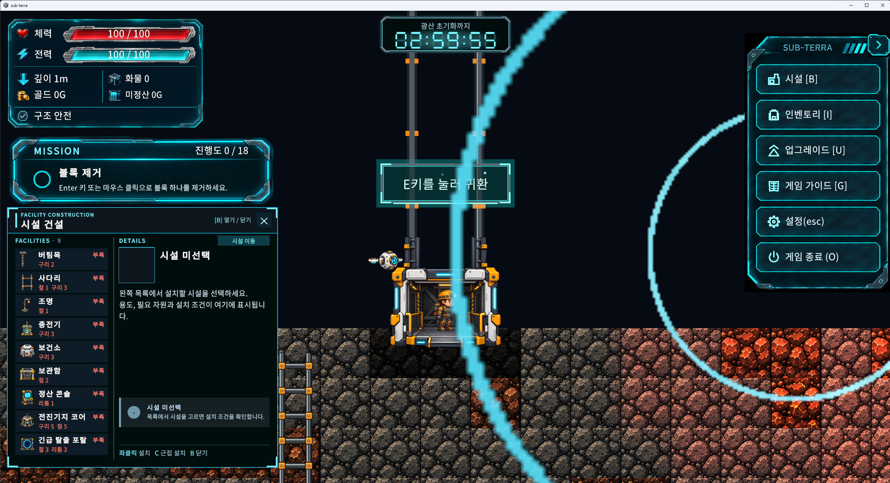
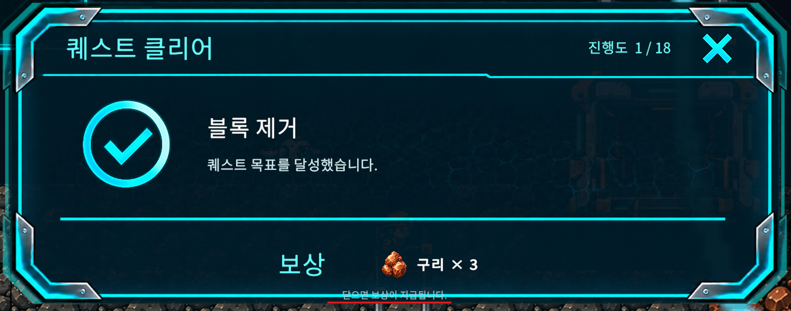
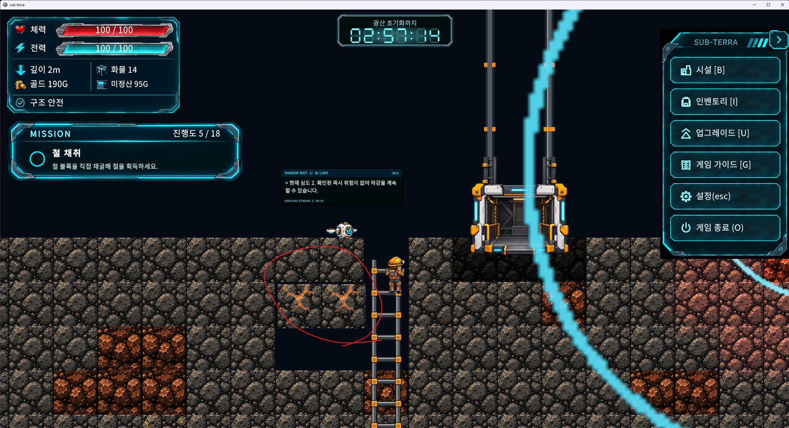
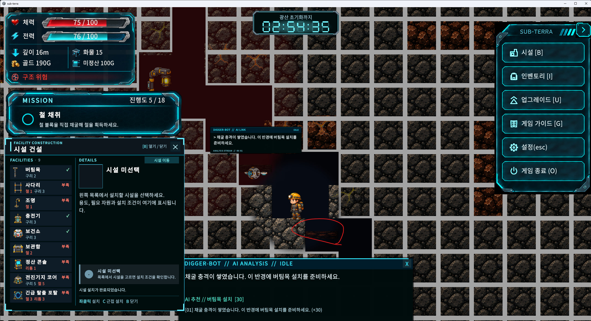
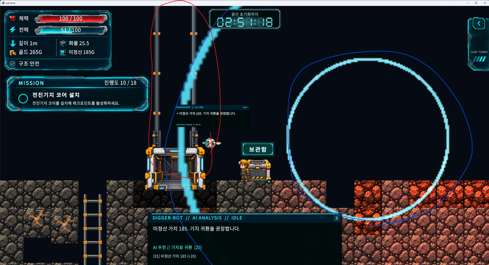

# 노트북 작업 인계 — 데스크탑 Demo 중간 시각 점검 (2026-10-13)

## 시작점과 검증 상태

2026-10-13 후속 작업: GitHub 이슈 #170/#171/#173/#174를 기준으로 런타임 및 Builder 수정을 진행했다. 세부 결과·미실행 화면 검수는 `visual-issues-170-174-20261013.md`를 읽는다. #159/#139는 기존 담당자 배정으로 이번 변경에서 제외했다. 아래 내용은 원본 피드백이며 완료 판정이 아니다.

사용자가 데스크탑 QA 빌드를 일반 조작으로 중간까지 플레이한 뒤 제공한 스크린샷 5장과 의견을 정리했다. 이번 요청은 **노트북에서 수정할 작업 기록 작성**이다. 제품 코드·씬·프리팹·아트를 이번에 수정하지 않았다.

- 기준 커밋: `bfbd7bd69ca65d4b80bcb20ec621456be788d42d` / PR #168.
- 데스크탑 브랜치: `codex/desktop-pr168-validation`. 포함된 main: `f23f00d6`.
- Unity: 6000.5.4f1. Git 루트 아래 `sub-terra/`가 Unity 프로젝트다.
- QA Windows x64 Build ID: `20261013-025940`, Save Version 5.
- ZIP SHA-256: `1804a98e9383e9a533401d8a74d1dc531c593b3c27bf9586ef5dd0e8b03525d7`.
- 이번 데스크탑 실제 통과: Unity 임포트·컴파일, 시설 이동 EditMode 검사 12/12, QA Windows 빌드 1회.
- 사용자 중간 플레이: 첨부 화면에서 퀘스트 진행 `10/18`까지 확인. 전체 Demo 완주·판매/업그레이드 후 재탐사·완전 종료 후 이어하기·시설 상태 보존·ComputeBuffer 종료 검증을 통과로 기록하지 않는다.
- 다른 Windows PC(미설치 Unity) 실행도 미검증이다. 기존 순수 관리형 통과 검사 7개·보건소 대기시간 검사는 반복하지 않았다.
- 원본 스크린샷 크기: 이미지 1·3은 2559×1392, 이미지 4는 2559×1391, 이미지 5는 2559×1389. 이미지 2는 보상 팝업 확대 이미지다. 채팅에 표시된 축소 이미지의 픽셀값을 UI 설계 치수로 쓰지 않는다.

작업 전 `AGENTS.md`, `init/rules`, `init/PRD.md`, `docs/INTEGRATION_GUIDE.md`, `desktop-handoff-20261012.md`, `demo-acceptance-preflight-20261012.md`를 적용한다. PR의 현재 병합 상태와 후속 커밋은 노트북에서 다시 확인한다. 이 문서만으로 PR 병합·커밋·푸시·패키지/버전 변경이 승인된 것은 아니다.

## 사용자 피드백과 작업 목록

| 번호 | 관찰된 문제 | 증거 | 우선순위 |
| --- | --- | --- | --- |
| V01 | 체력/전력 HUD, 미션, 시설 건설, 오른쪽 메뉴가 플레이 화면을 너무 많이 차지함 | 01, 03, 04, 05 | 높음: 시야·조작 공간 |
| V02 | `닫으면 보상이 지급됩니다.`가 하단 테두리에 가려져 잘 안 보임 | 02 | 높음: 보상 수령 안내 |
| V03 | 붕괴 위험 타일의 균열/움직임이 너무 요란하고 불안정하게 보임 | 03 빨간 원 | 중간: 위험 전달과 시각 피로 |
| V04 | 타일 낙하 후 잔재가 빈 공간에 남음 | 04 빨간 원 | 중간: 잔재 정리·누적 확인 |
| V05 | 엘리베이터 위쪽 레일/라인의 스타일과 접합이 본체와 어울리지 않음 | 05 빨간 원 | 중간: 시설 일체감 |
| V06 | 굵고 밝은 청록색 원형 효과가 화면을 가로지르며 어색함 | 01·03·05, 05 파란 원 | 중간: 효과의 의미·시야 |

아래 개선 방향은 다음 작업을 위한 제안이다. 원인 확정이나 구현 완료 기록이 아니다. 기존 청록색 SF 프레임·시설 아트의 언어는 유지하고 불필요한 면적·광량·움직임을 줄인다.

### V01 — UI 점유율과 정보 우선순위

**현상:** 체력창과 미션이 좌측 상단을 넓게 차지하고, 건설창을 열면 좌측 아래까지 덮인다. 우측 메뉴가 펼쳐진 상태에서는 양쪽에 큰 UI가 동시에 남는다. 이미지 04·05에서는 하단 드론 분석창도 플레이 영역을 추가로 가린다. 사용자가 말한 '오른쪽 설정창'은 설정 버튼을 포함한 우측 메뉴 전체로 기록한다.

**제안:**

- 체력·전력·구조 위험은 읽기 쉬운 크기로 계속 표시하되, 프레임/내부 여백을 먼저 줄인다. 수치와 글씨를 일괄 축소하는 방식은 피한다.
- 미션은 현재 목표 제목·진행도 중심의 간결한 표시를 기본으로 하고 긴 설명은 펼치기/세부 표시로 분리하는 안을 검토한다.
- 우측 메뉴는 기존 접기 기능을 활용한 기본 접힘 또는 작은 버튼 열을 검토한다. B/I/U/G/Esc 단축키와 메뉴 접근성은 보존한다.
- 건설창은 목록 행 간격·세부 설명 공간을 조절하고 선택 전 빈 영역을 줄인다. 시설 선택·이동·취소와 설치 미리보기 영역을 확보한다.
- 하단 분석창과 다른 패널이 함께 열리는 조합에서 겹침을 점검한다. 추가로 보이는 문제로 기록하며 드론 시스템 전체 개편으로 확대하지 않는다.
- 정확한 축소율은 미확정이다. HUD/미션/건설/우측 메뉴별로 조정하고 실제 화면 비교로 결정한다.

**확인 위치:** `sub-terra/Assets/_Project/Prefabs/UI/HUDCanvas.prefab`(uGUI CanvasScaler, 1920×1080 기준, match 0.5), `BasicHUD.prefab`, `BuildingMenu.prefab`; `Editor/DataValidation/PromptB106HudBuilder.cs`, `PromptB110BuildingMenuBuilder.cs`, `PromptB89UndergroundMenuBuilder.cs`, `Scripts/App/Integration/UndergroundMenuController.cs`, `Scripts/App/UI/Tutorial/DemoObjectiveView.cs`. 아래 축약 경로는 모두 `sub-terra/Assets/_Project/` 기준이다. 실제 씬 인스턴스와 런타임 레이아웃 적용도 확인한다.

**완료 기준:** 1920×1080과 첨부 이미지에 가까운 2560×1440 환경에서 기본 탐사/건설/미션 완료/메뉴 펼침 상태를 비교한다. 플레이어 주변과 설치 위치를 볼 수 있고, 글자·숫자·버튼을 읽고 누를 수 있어야 한다. 현재 단축키/접기/시설 이동 기능의 회귀가 없어야 한다.

### V02 — 보상 안내 문구 가림

**현상:** 이미지 02에서 `닫으면 보상이 지급됩니다.`가 패널 하단 장식선과 겹친다. 안내의 하단 여백과 대비가 부족하다.

**제안:** 안내를 보상 행 아래의 패널 내부 영역으로 올리고 충분한 안전 여백을 둔다. RectTransform anchor/pivot, 부모 Mask/RectMask2D, sibling 순서, 팝업 애니메이션 스케일을 확인한다. 테두리 아트를 바꾸기 전에 배치 원인을 확인한다.

**확인 위치:** `Editor/DataValidation/PromptB951QuestClearRewardUiBuilder.cs`의 `ClaimHint`(현재 위치 설정 `(142.5, -446)`, 크기 `840×24`, 글자 12), `Scripts/App/UI/Tutorial/DemoObjectivePresenter.cs`, `QuestClearPopupMotion.cs`; 실제 팝업 계층. 위치 값은 원인 조사 단서이며 이 기록에서 수정하지 않았다.

**완료 기준:** 구리 보상과 여러 보상이 있는 팝업에서 안내가 테두리에 닿거나 잘리지 않아야 한다. 닫기 버튼/기존 입력에 따른 보상 지급 시점·중복 지급 방지는 그대로 유지한다. UI 가독성 수정과 보상 로직 변경을 혼합하지 않는다.

### V03 — 붕괴 위험을 차분하고 자연스럽게 표현

**현상:** 이미지 03의 타일에 밝은 주황 균열이 두드러진다. 사용자는 떨어질 듯한 표현이 너무 요란하고 심란하다고 느꼈다. 정지 스크린샷으로 흔들림 속도나 점멸 주기를 측정한 것은 아니다.

**제안:** 암석 표면을 따라가는 가늘고 낮은 채도의 균열, 작은 먼지, 작은 진폭의 간헐적 떨림을 우선 검토한다. 평상시 경고는 안정적으로 표시하고, 실제 붕괴 직전에만 짧고 명확한 강조를 준다. 다수 타일의 지속적인 고속 흔들림/강한 발광은 줄인다. 색만으로 위험을 전달하지 않으며 기존 위험 단계와 회피할 수 있는 예고는 유지한다.

**확인 위치:** `Scripts/Gameplay/Structural/StructuralCrackOverlay.cs`, `StructuralCollapseSystem` 관련 구현/테스트, `Art/Tiles/Crack_Overlay/`, `Tilemaps/DemoWorld/CrackCaution.asset`, `CrackDanger.asset`, `CrackImminent.asset`. 코드상 shake distance/interval, pulse/telegraph 설정이 존재한다. 실제 프리팹·씬의 직렬화 값이 기본값을 덮어쓰는지 먼저 확인한다.

**완료 기준:** 주의/위험/붕괴 임박을 구분할 수 있고 플레이어 시선이 지속적으로 흔들리는 타일에 끌리지 않아야 한다. Reduce Motion 설정을 포함해 비교한다. 위험 점수·붕괴 판정·피해·타이밍은 시각 개선 때문에 임의 변경하지 않는다.

### V04 — 낙하 후 잔재 처리

**현상:** 이미지 04에서 캐릭터 우하단 빈 공간에 어두운 갈색의 납작한 잔재가 남아 보인다. 떠 있는지, 얼마나 오래 남는지, 재진입 시 유지되는지는 아직 미검증이다.

**코드에서 확인된 사실:** `StructuralCrackOverlay.UpdateFallingVisuals`는 낙하가 끝난 `StructuralFallingRock`을 갈색 alpha 0.5, scale `(1, 0.22, 1)`로 바꾼 뒤 `fallingVisuals` 목록에서 제거한다. 이 경로에서 Root를 제거하거나 잔재 수명을 등록하지 않는다. 주석도 비충돌 잔해를 남기는 의도를 명시한다. 이것이 이미지 04의 오브젝트인지는 런타임 확인이 필요하지만, 오래 남는 잔재를 조사할 직접적인 단서다.

**제안:** 낙하→짧은 착지 먼지→짧은 페이드아웃→오브젝트 회수 흐름으로 정리한다. 잔재를 유지한다면 실제 바닥 위에만 두고 수명·개수 상한을 둔다. 빈 공간에 납작한 텍스처가 고정되는 표현은 없앤다. 전체 화면의 흰 격자선은 이 스크린샷의 추가 맥락이며 이번 요청의 낙하 잔재와 동일 원인으로 단정하지 않는다.

**완료 기준:** 낙하/채굴을 구분해 재현하고 잔재·먼지가 의도된 시간 후 회수되는지 확인한다. 연속 붕괴로 오브젝트가 무제한 누적되지 않고 씬 재진입/이어하기에서도 유령 타일·충돌이 없어야 한다. 붕괴 피해와 타일 제거/저장 로직은 보존한다. 원인 확인 없이 Tilemap 전체를 지우지 않는다.

### V05 — 엘리베이터 레일과 본체의 일체감

**현상:** 이미지 05 빨간 표시의 길고 단순한 회색 레일과 반복 주황 연결 부품이 상세한 본체 아트에 비해 별개 구조처럼 보인다. 폭·접합점·명암·재질을 맞출 필요가 있다. 빨간 손그림 선은 사용자 표시이며 게임 효과가 아니다.

**제안:** 레일을 본체 좌우 가이드의 실제 연결점에 맞추고 재질/명암/주황 부품 크기를 통일한다. 하이라이트를 약하게 하며 짧은 연결 브래킷/겹침으로 경계가 끊기지 않게 한다. 프리팹 스케일·피벗과 이동 중 레일 기준점을 함께 확인한다. 문·플랫폼·이동 충돌·탑승 위치는 변경 범위를 분리한다.

**확인 위치:** `Scripts/Gameplay/Player/ElevatorDoorVisual.cs`의 `HoistRails`, `Editor/DataValidation/ElevatorVisualPrefabSetup.cs`, `PhaseCElevatorLadderBuilder.cs`의 ElevatorPrefabPath. 기존 Editor/builder로 작업하고 씬·프리팹 YAML을 직접 편집하지 않는다.

**완료 기준:** 정지/이동/문 열림·닫힘/귀환 상태에서 레일이 본체와 자연스럽게 연결되고 떨어져 보이지 않아야 한다. 이동과 탑승·귀환의 기존 기능은 유지한다.

### V06 — 청록색 원형 표시의 강도와 자연스러움

**현상:** 실제 게임의 밝고 두꺼운 청록색 원호가 엘리베이터·지형을 가로지르며 크게 나타난다. 이미지 05의 얇은 파란 손그림 선은 사용자 표시다. 개선 대상은 그 안쪽의 게임 원형 효과다. 스크린샷만으로 원의 소유자와 상시 표시 여부는 확정할 수 없다.

**제안:** 얇고 부드러운 가장자리, 낮은 opacity/발광, 표시 후 짧은 페이드로 시야 방해를 줄인다. 스캔 효과라면 한 번 확산하고 사라지는 짧은 펄스를 우선 검토한다. 시설 범위라면 건설·선택·호버 등 필요한 상황에서만 보이는 방식을 검토한다. 여러 원이 중첩될 때도 선 두께와 밝기가 과도해지지 않게 한다. 픽셀 아트와 어울리는 일관된 선처리를 유지한다.

**확인 위치:** `Scripts/Gameplay/Drone/DroneScanPulseView.cs`(런타임 Sprite 원형 스캔), `DroneSensor.cs`; `Scripts/Gameplay/Power/PowerSupplyRangeIndicator.cs`(LineRenderer 기반 공급/정화 범위). 먼저 스캔 시작/종료, 시설 설치·선택·범위 표시를 각각 재현해 어느 효과인지 특정한다. 밝은 원이라는 이유만으로 전력 범위라 단정하지 않는다.

**완료 기준:** 효과의 의미가 구분되고 플레이어·시설·위험 타일을 가리지 않아야 한다. 표시 수명·씬 종료 시 회수가 정상이어야 한다. 시각적 원 경계는 실제 스캔/공급/정화 범위와 일치해야 하며 판정 반경을 줄여 해결하지 않는다.

## 노트북 작업 순서와 검증 원칙

1. 기준 커밋/PR 상태와 사용자 변경을 확인하고 이미지 01~05를 읽는다. 오래된 로컬 빌드로 재현했다고 오인하지 않는다.
2. V02 가림을 먼저 수정하고 V01 패널 점유율을 조정한다. 실제 계층·런타임 생성·Builder를 확인한 뒤 최소 범위로 수정한다.
3. V04 잔재의 생성/수명/회수를 확인해 해결한다. 이어서 V03의 균열·떨림을 차분하게 조정한다.
4. V05 레일 정렬/재질과 V06 원형 효과를 각각 비교한다. A/B 소유권과 통합 경계를 유지한다.
5. 항목별 전후 스크린샷과 실제 해상도·변경 파일·관련 검사 결과를 남긴다. 실패한 변경 위에 다른 수정을 계속 쌓지 않는다.
6. 변경된 흐름의 좁은 검증부터 실행한다. 관련 로직이 안 바뀌면 이미 통과한 시설 이동 12개·관리형 검사를 반복하지 않는다. 시각 변경의 통과는 실제 화면으로 확인한다.
7. 이 시각 피드백 처리 후 중단했던 Demo 완주→귀환·판매/업그레이드→재탐사→완전 종료→이어하기→ComputeBuffer 종료 로그 검증을 이어간다. 자동 테스트 통과나 퀘스트 10/18을 Demo 완료로 기록하지 않는다.

ProjectSettings/manifest/lock/버전은 변경하지 않는다. .meta GUID·사용자 슬롯·stash를 보존한다. 진행 불가나 저장 손실을 발견하면 미관 개선보다 먼저 원인을 확인한다. 이번 문서 작성 때문에 테스트·빌드를 추가 실행하지 않았다.

## 증거 이미지

원본을 임시 클립보드 경로에서 다음 상대 경로로 복사했다. 문서와 이미지 폴더를 함께 전달하면 노트북에서도 열린다.

### 01 — UI 점유율과 큰 원형 표시

### 02 — 보상 안내 하단 가림

### 03 — 붕괴 위험 타일 표현

### 04 — 낙하 후 잔재

### 05 — 엘리베이터 레일과 원형 효과

## 다음 Codex에 전달할 요청

`work_process/notebook-visual-review-20261013.md`와 첨부 이미지 5장을 기준으로 V01~V06을 순서대로 수정해 주세요. 현재 HUD/미션/시설창/우측 메뉴의 시야 점유율과 보상 안내 가림을 먼저 해결하고, 붕괴 잔재의 수명·회수, 차분한 붕괴 예고, 엘리베이터 레일의 일체감, 청록색 원형 효과를 다듬어 주세요. 기존 SF 스타일과 조작·보상·붕괴·저장·범위 판정은 보존하고 기존 Builder/Editor 작업 흐름을 사용하세요. 스크린샷에서 확정할 수 없는 효과 소유자와 원인은 재현 후 결정하세요. 진행 불가·저장 손실을 발견하면 우선 처리하고, 관련 검사만 실행하세요. 전체 Demo 완주와 이어하기·Windows 종료 검증은 아직 완료되지 않았습니다. 사용자 변경·stash·저장 슬롯을 보존하고 팀원의 PR을 임의 병합하거나 승인 없이 커밋·푸시하지 마세요.
